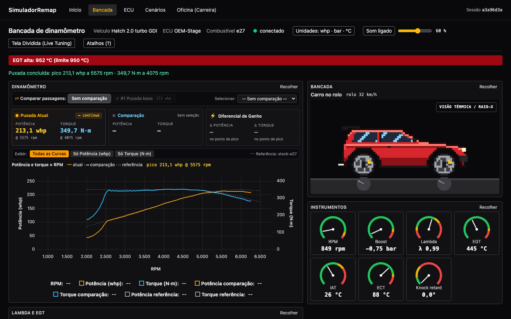
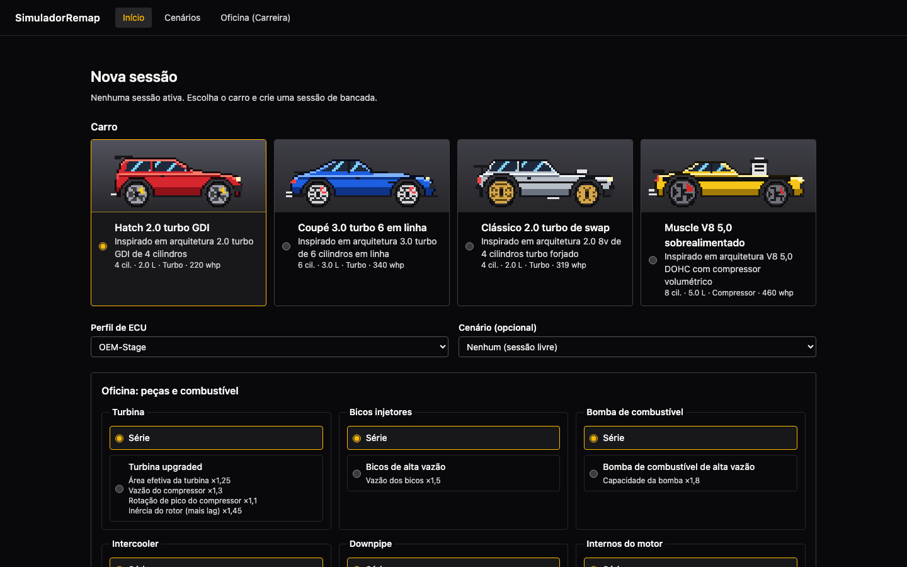
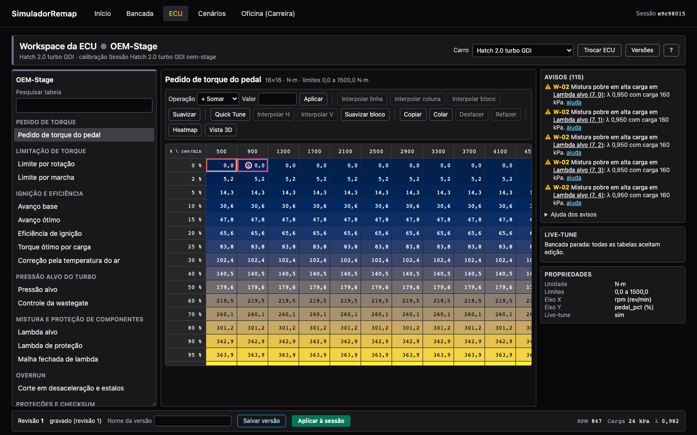
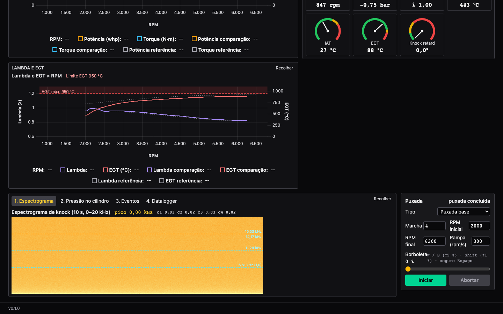
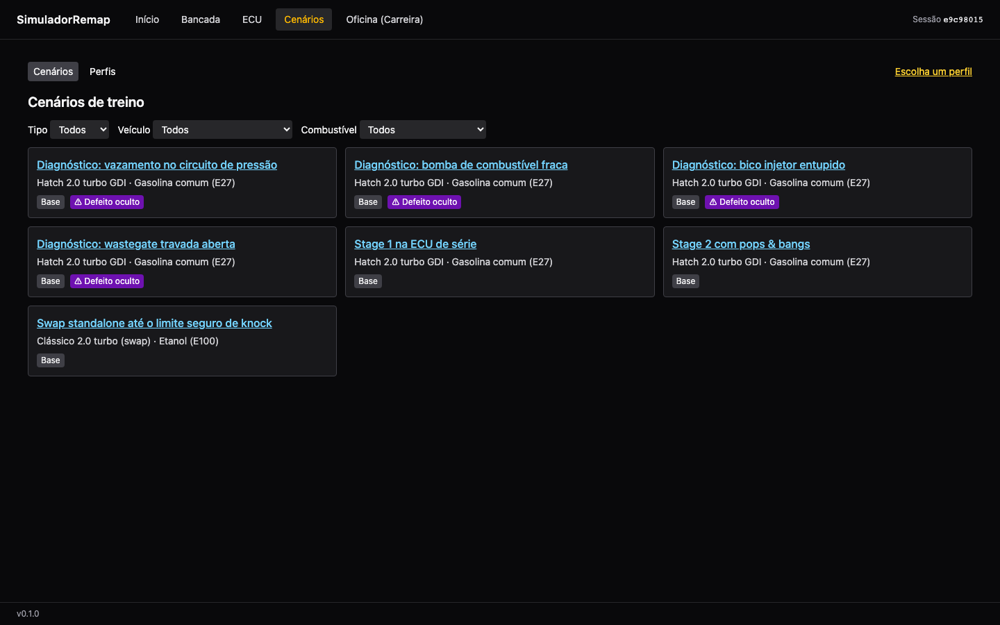

# SimuladorRemap

Simulador de calibração de ECU (remap) em dinamômetro virtual. Treine Stage 1, Stage 2, pops & bangs e swap para ECU standalone sem carro, sem rolo e sem risco de quebrar um motor.



## Por que existe

Aprender calibração na prática exige um carro, horas de dinamômetro e aceitar o risco de quebrar bielas, pistões ou turbinas. Os softwares de ECU editam tabelas offline, mas não simulam o motor. Os jogos simulam o carro, mas não oferecem programação completa de ECU.

O SimuladorRemap junta as duas coisas:

- **Motor físico 0D/1D** com eficiência volumétrica, combustão, turbo/supercharger, lambda, EGT e limiar de detonação.
- **ECU editável** com tabelas 2D/3D de torque, ignição, pressão alvo, lambda, malha fechada, overrun e proteções.
- **Dinamômetro virtual** com puxada base, varredura, carga estacionária e comparação antes × depois.
- **Falhas mecânicas** (knock, pré-ignição, EGT excessiva, biela, pistão, turbina) com laudo forense da causa.
- **Cenários de treino** avaliados automaticamente, incluindo diagnóstico de defeitos ocultos.
- **Oficina (carreira)** com perfis de jogador, peças e combustíveis.

Público-alvo: alunos de preparação, preparadores em transição para standalone e instrutores de escolas técnicas. Detalhes em [`_reversa_sdd/prd.md`](_reversa_sdd/prd.md) e [`_reversa_sdd/personas.md`](_reversa_sdd/personas.md).

## Telas

### Nova sessão

Escolha o carro, o perfil de ECU, o cenário opcional e as peças da oficina.



O catálogo tem quatro carros de ciclo Otto:

| Carro | Arquitetura | Uso típico |
|---|---|---|
| Hatch 2.0 turbo GDI | 4 cil. · 2.0 L · turbo · injeção direta | Stage 1 / Stage 2 em ECU OEM |
| Coupé 3.0 turbo 6 em linha | 6 cil. · 3.0 L · turbo | Carro preparado |
| Clássico 2.0 turbo de swap | 4 cil. · 2.0 L · turbo forjado | Swap para ECU standalone |
| Muscle V8 5,0 sobrealimentado | 8 cil. · 5.0 L · compressor | V8 com supercharger |

### Workspace da ECU

Edite as tabelas com heatmap, interpolação, suavização, Quick Tune e vista 3D. O painel de avisos aponta riscos antes da puxada. Salve versões e aplique-as à sessão.



### Bancada: lambda, EGT e knock

A cockpit mostra lambda e EGT por rotação, instrumentos em tempo real e o espectrograma de knock por cilindro. O datalogger e a pressão no cilindro ficam nas abas ao lado.



### Cenários de treino

Filtre por tipo, veículo e combustível. Cenários com defeito oculto treinam o diagnóstico.



## Arquitetura

Monólito modular servido por um único processo.

```
frontend/  React 18 + Vite + TypeScript + Tailwind 4 (SPA; uPlot, Three.js, zod)
backend/   FastAPI + SQLModel/Alembic + NumPy (Python 3.12)
  src/simremap/
    api/        REST /api/v1 + WebSocket de telemetria; serve o SPA
    physics/    modelo termodinâmico do motor
    ecu/        núcleo da ECU e estratégias
    profiles/   perfis de ECU (OEM, standalone)
    dyno/       puxadas e resultados do dinamômetro
    damage/     knock, falhas mecânicas e laudo
    telemetry/  datalogger e streaming
    catalog/    catálogo de veículos e benchmark de referência
    scenarios/  cenários de treino e avaliação
    career/     oficina, perfis de jogador e peças
    db/         persistência e migrações
  rust/simremap_rs/  kernels nativos opcionais (PyO3 + maturin)
scripts/   portão de qualidade, smoke do container, exportação OpenAPI
```

Pontos-chave:

- Laço de simulação determinístico de 100 a 1000 Hz (padrão 1000 Hz).
- Telemetria para a UI entre 30 e 60 FPS via WebSocket.
- SQLite por padrão; PostgreSQL 16 e Redis são opcionais.
- Os tipos do frontend são gerados do OpenAPI do backend (orval).

As especificações de cada módulo estão em [`_reversa_sdd/sdd/`](_reversa_sdd/sdd/). O mini-site visual da documentação está em [`_reversa_docs/index.html`](_reversa_docs/index.html).

## Requisitos

| Ferramenta | Versão | Uso |
|---|---|---|
| Docker + Compose | recente | Execução em container (opção mais simples) |
| Python | 3.12 | Backend sem Docker |
| [uv](https://docs.astral.sh/uv/) | recente | Dependências Python |
| Node.js | ≥ 20.19 | Frontend |
| Rust + cargo | estável | Opcional: kernels nativos |

Hardware de referência: CPU de 4 núcleos e 8 GB de RAM, sem GPU dedicada.

## Como rodar

Execute `make help` para listar todos os alvos.

### Opção 1: Docker (recomendado)

1. Construa a imagem:
   ```bash
   make build
   ```
2. Suba o container:
   ```bash
   make up
   ```
3. Abra <http://127.0.0.1:8000>.
4. Pare o container:
   ```bash
   make down
   ```

O container escuta só em `127.0.0.1`. Os dados ficam no volume `simremap-data`. Use `make logs` para ver os logs JSON.

### Opção 2: desenvolvimento local, sem Docker

1. Instale as dependências a partir dos lockfiles:
   ```bash
   make install
   ```
2. Suba o backend (porta 8000, com `--reload`) e o Vite (porta 5173):
   ```bash
   make dev
   ```
3. Abra <http://localhost:5173>.

Os dados de desenvolvimento ficam em `backend/.data/`.

### Opção 3: desenvolvimento com Docker

```bash
docker compose -f compose.yaml -f compose.dev.yaml up
```

O backend fica em `127.0.0.1:8000` e o Vite em `127.0.0.1:5173`.

### Kernels nativos em Rust (opcional)

A extensão `simremap_rs` acelera a física. Sem ela, o backend usa a implementação Python de referência.

```bash
make native
```

Controle o uso com `SIMREMAP_NATIVE`:

- `auto` (padrão): usa a extensão se ela existir.
- `off`: nunca usa a extensão.
- `on`: exige a extensão e falha sem ela.

## Configuração

Todas as variáveis usam o prefixo `SIMREMAP_`. As principais:

| Variável | Padrão | Descrição |
|---|---|---|
| `SIMREMAP_ENV` | `prod` | `dev`, `test`, `staging` ou `prod` |
| `SIMREMAP_DATA_DIR` | `/data` | Diretório de dados (SQLite, logs de puxada) |
| `SIMREMAP_STATIC_DIR` | `/app/static` | Build do frontend servido pelo backend |
| `SIMREMAP_DATABASE_URL` / `DATABASE_URL` | SQLite em `DATA_DIR` | URL de PostgreSQL, se usado |
| `SIMREMAP_REDIS_URL` | — | Cache Redis opcional |
| `SIMREMAP_LOG_LEVEL` | `INFO` | `DEBUG`, `INFO`, `WARNING`, `ERROR` |
| `SIMREMAP_SIM_HZ` | `1000` | Frequência do laço de simulação (100–1000) |
| `SIMREMAP_WS_FPS` | `50` | Quadros de telemetria por segundo (30–60) |
| `SIMREMAP_MAX_ACTIVE_SESSIONS` | `1` | Sessões de bancada simultâneas (1–2) |
| `SIMREMAP_BIND_PUBLIC` | `false` | Libera escuta em `0.0.0.0` |
| `SIMREMAP_NATIVE` | `auto` | Uso dos kernels Rust |

A lista completa está em [`backend/src/simremap/core/config.py`](backend/src/simremap/core/config.py).

## Qualidade e testes

| Comando | O que faz |
|---|---|
| `make check` | Portão completo: ruff, mypy `--strict`, bandit, pytest, cobertura ≥ 85 % por pacote, paridade OpenAPI, eslint, tsc e vitest |
| `make test` | Só os testes do backend com cobertura |
| `make fe-test` | Só os testes do frontend (vitest) |
| `make e2e` | Jornadas ponta a ponta no backend e no Playwright |
| `make e2e-local` | Playwright em Chromium contra duas estações locais, sem Docker |
| `make bench` | Benchmarks de física, ECU, laço e workers |
| `make accuracy` | Desvio < 5 % contra o Reference Benchmark Baseline v1 |
| `make test-postgres` | Migrações em PostgreSQL 16 |
| `make smoke` | Teste de fumo do container |

Depois de alterar a API, regenere os tipos do frontend:

```bash
make api-types
```

## API

- REST em `/api/v1` (ex.: `/api/v1/health`, `/api/v1/version`, `/api/v1/sessions`).
- Erros no formato `application/problem+json`.
- Contrato OpenAPI exportado em [`frontend/openapi.json`](frontend/openapi.json).

## Documentação do projeto

| Caminho | Conteúdo |
|---|---|
| [`_reversa_sdd/prd.md`](_reversa_sdd/prd.md) | PRD: problema, métricas e escopo |
| [`_reversa_sdd/sdd/`](_reversa_sdd/sdd/) | Especificações por módulo |
| [`_reversa_forward/`](_reversa_forward/) | Histórico das features implementadas |
| [`_reversa_docs/`](_reversa_docs/) | Mini-site visual (arquitetura, métricas, glossário) |
