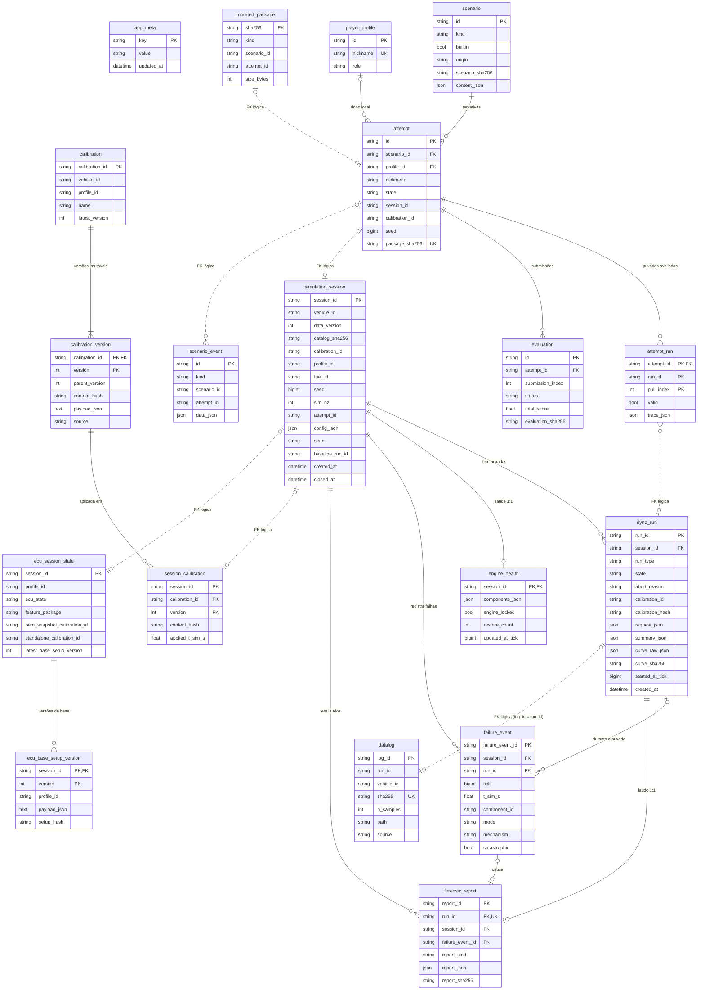

# Modelo de dados — 001-simulador-remap

> Feature: `_reversa_forward/001-simulador-remap/`. Fase: reversa-plan (modo autônomo).
> Este arquivo substitui o `data-delta.md` do template, a pedido do usuário. O projeto é greenfield: o "legado" é vazio, então o delta é o modelo inteiro e todo item é `componente-novo`.
> Âncoras: `_reversa_sdd/prd.md` (inclui "Decisões de integração (revisão R1)"), `_reversa_forward/001-simulador-remap/requirements.md` e as seções 9 e 13 das 11 specs em `_reversa_sdd/sdd/`.
> Confidência: 🟢 CONFIRMADO, 🟡 INFERIDO (padrão, specs planejadas), 🔴 LACUNA / benchmark pendente.

---

## 1. Visão geral e convenções

### 1.1 Resumo

| Item | Valor | Fonte | Conf. |
|------|-------|-------|-------|
| Tabelas persistidas (domínio) | 19, em 7 componentes donos | seções 9 das specs | 🟡 |
| Tabela de infraestrutura | `alembic_version` (gerida pelo Alembic, fora da contagem) | `platform-foundation.md#RF-10` | 🟡 |
| Migrações Alembic | 7, cadeia linear, 1 head | `platform-foundation.md#9-modelo-de-dados` | 🟡 |
| Componentes sem tabelas | `engine-physics-core`, `vehicle-catalog`, `dyno-cockpit-ui`, `ecu-tuning-ui` | seções 9 dessas specs | 🟡 |
| Dados de arquivo versionados | catálogo JSON, descritores e hardware de perfis, cenários base, `DamageConfig` | `vehicle-catalog.md#9`, `ecu-profiles.md#9`, `training-scenarios.md#RF-04` | 🟡 |
| Dados de arquivo gerados em runtime | `/data/logs/{run_id}.simlog.gz`, pacotes `SignedPackage`, backups do SQLite | `telemetry-datalogger.md#9`, `training-scenarios.md#9`, `platform-foundation.md#13` | 🟡 |

### 1.2 Convenções (dono: `platform-foundation`)

- 🟡 **ORM e acesso:** SQLModel sobre SQLAlchemy 2 asyncio. Sessão por pedido com `expire_on_commit=False` e rollback automático em exceção. Arquivos: `backend/src/simremap/db/{engine.py,base.py}`, modelos em `backend/src/simremap/db/models/<componente>.py`, migrações em `backend/src/simremap/db/migrations/versions/`. Fonte: `platform-foundation.md#9-modelo-de-dados`.
- 🟡 **Bancos suportados:** SQLite (`sqlite+aiosqlite:////data/simremap.db`, padrão) e PostgreSQL 16 (`postgresql+asyncpg://`, staging ou servidor local). Outro driver falha no arranque. SQLite aplica `journal_mode=WAL`, `foreign_keys=ON`, `busy_timeout=5000`, `synchronous=NORMAL`. As migrações usam `render_as_batch=True` para SQLite.
- 🟡 **Nomes:** tabelas em `snake_case` no singular (`dyno_run`, `datalog`). Constraints pela `NAMING_CONVENTION` de `simremap/db/base.py`: `pk_<tabela>`, `fk_<tabela>_<coluna>_<tabela_ref>`, `ix_<tabela>_<colunas>`, `uq_<tabela>_<colunas>`, `ck_<tabela>_<nome>`.
- 🟡 **Chave primária:** `String(36)` para UUID4 em texto, `String(26)` para ULID (ordenável), `String(64)` para slug canônico (`hatch-20t-gdi`, `stage1-oem`) ou `calibration_id`. O nome da coluna PK segue o componente dono (ver D-02).
- 🟡 **Timestamps:** `DateTime(timezone=True)` em UTC, com `server_default=func.now()` e `onupdate` via `TimestampMixin`. O relógio de parede só é lido fora do laço físico. Dentro do laço, o tempo é `tick` (`BigInteger`) e `t_sim_s` (`Float`). Nenhum hash inclui relógio de parede.
- 🟡 **Hashes:** SHA-256 em hexadecimal minúsculo, `String(64)`, padrão `^[0-9a-f]{64}$`. Regras de canonicalização na seção 7.1.
- 🟡 **JSON:** coluna `JSON` com variante `JSONB` em PostgreSQL (texto em SQLite). Calibração e base de setup usam `Text` com JSON canônico (ver D-08). Binários usam `LargeBinary`; o MVP não grava binários no banco.
- 🟡 **Enumerações:** gravadas como `String(n)` com `CheckConstraint` dos valores do `StrEnum` dono. Não se usa `ENUM` nativo do PostgreSQL, para manter paridade com SQLite e migrações simples.
- 🟡 **Inteiros grandes:** `seed` (0 a 2^63 − 1), `tick` e tamanhos em bytes usam `BigInteger`.
- 🟡 **Integridade referencial:** FKs físicas só dentro do mesmo componente ou para tabelas de migração anterior. Referências entre componentes que podem receber dados importados ou que apontam para tabela criada depois ficam como "FK lógica" (coluna indexada, validada no serviço). `ON DELETE RESTRICT` em todas as FKs físicas (ver 7.4).

---

## 2. Entidades persistidas por componente

Legenda das colunas: **N** = aceita nulo (S/N). **Padrão** = valor padrão no servidor ou no modelo. **Restrição** = `CHECK`, `UNIQUE` ou regra do domínio.

### 2.1 `platform-foundation` — migração `0001_foundation_base` (Sprint 1)

Fonte: `_reversa_sdd/sdd/platform-foundation.md#9-modelo-de-dados`, `#RF-10`.

#### `app_meta`

| Coluna | Tipo | N | Padrão | Restrição / nota |
|--------|------|---|--------|------------------|
| `key` | `String(64)` | N | — | PK. Valores: `install_id`, `schema_created_at`, `last_boot_app_version`. |
| `value` | `String(512)` | N | — | Texto. `install_id` é UUID4 local, sem relação com pessoa. |
| `updated_at` | `DateTime(tz)` | N | `now()` | UTC. |

- 🟡 Índices: só a PK. Dono: `platform-foundation`.

### 2.2 `dyno-bench` — migração `0002_dyno_sessions_runs` (Sprint 2)

Fonte: `_reversa_sdd/sdd/dyno-bench.md#9-modelo-de-dados`.

#### `simulation_session`

| Coluna | Tipo | N | Padrão | Restrição / nota |
|--------|------|---|--------|------------------|
| `session_id` | `String(36)` | N | — | PK. UUID4 hex (32 caracteres, formato do dono). |
| `vehicle_id` | `String(48)` | N | — | FK lógica para o catálogo (`VehicleId`). Índice. |
| `data_version` | `Integer` | N | — | `VehicleSpec.data_version` no momento da criação (D-05). |
| `catalog_sha256` | `String(64)` | N | — | Hash do manifesto do catálogo (D-05). |
| `calibration_id` | `String(64)` | N | — | Calibração inicial. `None` no request vira `stock_calibration_id`. |
| `profile_id` | `String(16)` | N | `'oem-stage'` | CK em `oem-stage`, `ft-pro`, `m1-race`, `ht-elite`. Perfil inicial. |
| `fuel_id` | `String(16)` | N | — | CK em `e27`, `e100`, `podium`, `e0`. `None` no request vira `stock_fuel_id` (D-05). |
| `seed` | `BigInteger` | N | — | CK 0 ≤ seed ≤ 2^63 − 1. Sorteada se ausente no request. |
| `sim_hz` | `Integer` | N | `1000` | CK 100 ≤ sim_hz ≤ 1000. |
| `attempt_id` | `String(36)` | S | `NULL` | FK lógica para `attempt.id` (tabela criada no Sprint 4). Índice (D-05). |
| `config_json` | `JSON` | N | — | `ambient`, `rig`, `correction_standard`, `operator_protection`, `egt_abort_enabled`, `damage_enabled`, `physics_faults`. |
| `state` | `String(16)` | N | `'ready'` | CK em `ready`, `running`, `engine_locked`, `closed`. Índice (contagem de capacidade, `SIM_CAPACITY_EXCEEDED`). |
| `baseline_run_id` | `String(26)` | S | `NULL` | FK lógica para `dyno_run.run_id` (evita ciclo de FK). |
| `created_at` | `DateTime(tz)` | N | `now()` | UTC. |
| `closed_at` | `DateTime(tz)` | S | `NULL` | Preenchido por `DELETE /api/v1/sessions/{session_id}`. A linha nunca é apagada. |

- 🟡 Índices: `ix_simulation_session_vehicle_id`, `ix_simulation_session_state`, `ix_simulation_session_attempt_id`.

#### `dyno_run`

| Coluna | Tipo | N | Padrão | Restrição / nota |
|--------|------|---|--------|------------------|
| `run_id` | `String(26)` | N | — | PK. ULID. Também é o `log_id` do datalog simulado. |
| `session_id` | `String(36)` | N | — | FK → `simulation_session.session_id`, `RESTRICT`. |
| `run_type` | `String(24)` | N | — | CK em `baseline_pull`, `sweep_pull`, `steady_state_hold`, `multi_pull`. |
| `state` | `String(16)` | N | `'idle'` | CK nos valores de `RunState` (`idle` … `engine_failed`). |
| `abort_reason` | `String(32)` | S | `NULL` | CK nos valores de `AbortReason`. |
| `calibration_id` | `String(64)` | N | — | Calibração aplicada no início da puxada (D-06). |
| `calibration_hash` | `String(64)` | N | — | `content_hash` aplicado. |
| `request_json` | `JSON` | N | — | `DynoRunRequest` completo (inclui `probe`). |
| `summary_json` | `JSON` | S | `NULL` | `RunSummary`. |
| `curve_raw_json` | `JSON` | N | `'[]'` | Curva bruta, ≤ 400 pontos agregados por puxada. A curva suavizada é recalculada na leitura. |
| `pulls_json` | `JSON` | S | `NULL` | Só `multi_pull`. |
| `repeatability_json` | `JSON` | S | `NULL` | `peak_whp_spread_pct`, `peak_torque_spread_pct` (D-06). |
| `curve_sha256` | `String(64)` | S | `NULL` | Hash canônico da curva bruta. |
| `started_at_tick` | `BigInteger` | N | — | Tick de início. |
| `ended_at_tick` | `BigInteger` | S | `NULL` | Tick de fim. |
| `created_at` | `DateTime(tz)` | N | `now()` | UTC. |

- 🟡 Índices: `ix_dyno_run_session_id_created_at` (dono), `ix_dyno_run_curve_sha256`.

### 2.3 `knock-and-failure-model` — migração `0003_damage_health_reports` (Sprint 2)

Fonte: `_reversa_sdd/sdd/knock-and-failure-model.md#9-modelo-de-dados`. Depende de `0002_dyno_sessions_runs`.

#### `engine_health`

| Coluna | Tipo | N | Padrão | Restrição / nota |
|--------|------|---|--------|------------------|
| `session_id` | `String(36)` | N | — | PK e FK → `simulation_session.session_id`, `RESTRICT`. Relação 1:1. |
| `components_json` | `JSON` | N | — | `list[ComponentHealth]`. |
| `engine_locked` | `Boolean` | N | `false` | — |
| `restore_count` | `Integer` | N | `0` | CK ≥ 0. |
| `rod_weights_json` | `JSON` | N | — | Pesos `w_i` sorteados por biela (auditoria). |
| `updated_at_tick` | `BigInteger` | N | — | Escrita no fim da puxada, em cada falha e em cada restauração; nunca por tick. |
| `updated_at` | `DateTime(tz)` | N | `now()` | UTC. |

#### `failure_event`

| Coluna | Tipo | N | Padrão | Restrição / nota |
|--------|------|---|--------|------------------|
| `failure_event_id` | `String(26)` | N | — | PK. ULID. |
| `session_id` | `String(36)` | N | — | FK → `simulation_session.session_id`, `RESTRICT`. |
| `run_id` | `String(26)` | S | `NULL` | FK → `dyno_run.run_id`, `RESTRICT`. `NULL` fora de puxada. |
| `tick` | `BigInteger` | N | — | CK ≥ 0. |
| `t_sim_s` | `Float` | N | — | CK ≥ 0. |
| `cylinder` | `Integer` | S | `NULL` | CK 1..8. |
| `component_id` | `String(16)` | N | — | Padrão `piston:<k>`, `rod:<k>`, `valves:<k>`, `head_gasket`, `bearings`, `turbo:turbine`. |
| `mode` | `String(24)` | N | — | CK nos 6 valores de `FailureMode`. |
| `mechanism` | `String(32)` | N | — | CK nos 13 valores de `FailureMechanism`. |
| `catastrophic` | `Boolean` | N | — | — |
| `simulated_only` | `Boolean` | N | `false` | `true` com dano desligado. |
| `health_after` | `Float` | N | — | CK 0..1 (D-07). |
| `causal_json` | `JSON` | N | — | `causal_variables`. |

- 🟡 Índices: `ix_failure_event_session_id_t_sim_s` (dono), `ix_failure_event_run_id`.

#### `forensic_report`

| Coluna | Tipo | N | Padrão | Restrição / nota |
|--------|------|---|--------|------------------|
| `report_id` | `String(26)` | N | — | PK. ULID. |
| `run_id` | `String(26)` | N | — | FK → `dyno_run.run_id`, `RESTRICT`. `UNIQUE` (1 laudo por puxada). |
| `session_id` | `String(36)` | N | — | FK → `simulation_session.session_id`, `RESTRICT`. |
| `failure_event_id` | `String(26)` | S | `NULL` | FK → `failure_event.failure_event_id`, `RESTRICT`. `NULL` em `near_miss`. |
| `report_kind` | `String(16)` | N | — | CK em `failure`, `near_miss`. |
| `report_json` | `JSON` | N | — | `ForensicReport` completo, ≤ 64 KB (validado no serviço). |
| `report_sha256` | `String(64)` | N | — | Hash do JSON canônico sem o próprio campo. |
| `generator_version` | `String(16)` | N | — | SemVer dos textos e regras. |
| `created_at` | `DateTime(tz)` | N | `now()` | UTC, fora do laço. |

- 🟡 Índices: `uq_forensic_report_run_id`, `ix_forensic_report_session_id`.

### 2.4 `ecu-core` — migração `0004_ecu_calibrations` (Sprint 2)

Fonte: `_reversa_sdd/sdd/ecu-core.md#9-modelo-de-dados`.

#### `calibration`

| Coluna | Tipo | N | Padrão | Restrição / nota |
|--------|------|---|--------|------------------|
| `calibration_id` | `String(64)` | N | — | PK. UUID4 texto para calibrações do usuário; slug `stock-<vehicle_id>-<profile_id>` para calibrações de fábrica (D-04). |
| `vehicle_id` | `String(48)` | N | — | FK lógica para o catálogo. |
| `profile_id` | `String(16)` | N | — | CK nos 4 `EcuProfileId`. |
| `name` | `String(80)` | N | — | `metadata.name` da última versão. |
| `latest_version` | `Integer` | N | `1` | CK ≥ 1. Base da concorrência otimista (`base_version`). |
| `created_at` | `DateTime(tz)` | N | `now()` | UTC. |
| `updated_at` | `DateTime(tz)` | N | `now()` | UTC, `onupdate`. |

- 🟡 Índices: `ix_calibration_vehicle_id_profile_id` (dono).

#### `calibration_version`

| Coluna | Tipo | N | Padrão | Restrição / nota |
|--------|------|---|--------|------------------|
| `calibration_id` | `String(64)` | N | — | PK composta e FK → `calibration.calibration_id`, `RESTRICT`. |
| `version` | `Integer` | N | — | PK composta. CK ≥ 1. Versão imutável. |
| `parent_version` | `Integer` | S | `NULL` | CK ≥ 1. Linhagem dentro da mesma calibração. |
| `content_hash` | `String(64)` | N | — | Índice não único (um `revert` repete o hash). |
| `payload_json` | `Text` | N | — | `Calibration` completa sem `calibration_id`/`version`, JSON canônico (D-08). |
| `author_nickname` | `String(24)` | S | `NULL` | Único dado de usuário permitido (seção 7.3). |
| `source` | `String(16)` | N | `'user'` | CK em `user`, `wizard`, `oem_stock`, `import`, `clone`, `revert`, `reference`. |
| `change_summary` | `String(200)` | N | `''` | Ex.: `ignition_base: 12 células`. |
| `created_at` | `DateTime(tz)` | N | `now()` | UTC, fora do laço. |

- 🟡 Índices: `ix_calibration_version_content_hash` (dono).

#### `session_calibration`

| Coluna | Tipo | N | Padrão | Restrição / nota |
|--------|------|---|--------|------------------|
| `session_id` | `String(36)` | N | — | PK. FK lógica para `simulation_session` (dono). |
| `calibration_id` | `String(64)` | N | — | FK composta (`calibration_id`, `version`) → `calibration_version`, `RESTRICT` (D-09). |
| `version` | `Integer` | N | — | — |
| `content_hash` | `String(64)` | N | — | Cópia do hash aplicado (leitura rápida pelo worker). |
| `applied_t_sim_s` | `Float` | N | — | Fronteira de tick da aplicação atômica. |

- 🟡 É a fonte de verdade da calibração ativa. `simulation_session.calibration_id` guarda só a inicial (D-10).

### 2.5 `ecu-profiles` — migração `0005_profiles_session_state` (Sprint 3)

Fonte: `_reversa_sdd/sdd/ecu-profiles.md#9-modelo-de-dados`.

#### `ecu_session_state`

| Coluna | Tipo | N | Padrão | Restrição / nota |
|--------|------|---|--------|------------------|
| `session_id` | `String(36)` | N | — | PK. FK lógica para `simulation_session` (dono). |
| `profile_id` | `String(16)` | N | — | CK nos 4 `EcuProfileId`. Perfil atual (muda no swap). |
| `ecu_state` | `String(24)` | N | `'oem'` | CK em `oem`, `awaiting_base_setup`, `standalone_ready`. |
| `feature_package` | `String(8)` | N | `'base'` | CK em `base`, `race`. |
| `oem_snapshot_calibration_id` | `String(64)` | S | `NULL` | Snapshot ao sair do `oem-stage`. |
| `oem_snapshot_version` | `Integer` | S | `NULL` | — |
| `standalone_calibration_id` | `String(64)` | S | `NULL` | Calibração gerada pelo assistente. |
| `latest_base_setup_version` | `Integer` | S | `NULL` | Base de `base_version` no `PUT` da base. |
| `hardware_override_json` | `Text` | S | `NULL` | `HardwareOverride` vindo do `training-scenarios`. Nunca exposto na API. |
| `updated_at` | `DateTime(tz)` | N | `now()` | UTC, `onupdate`. |

#### `ecu_base_setup_version`

| Coluna | Tipo | N | Padrão | Restrição / nota |
|--------|------|---|--------|------------------|
| `session_id` | `String(36)` | N | — | PK composta e FK → `ecu_session_state.session_id`, `RESTRICT` (D-09). |
| `version` | `Integer` | N | — | PK composta. CK ≥ 1. |
| `profile_id` | `String(16)` | N | — | CK nos 4 `EcuProfileId`. |
| `payload_json` | `Text` | N | — | `BaseSetup` em JSON canônico. |
| `setup_hash` | `String(64)` | N | — | Índice (dono). |
| `created_at` | `DateTime(tz)` | N | `now()` | UTC. |

- 🟡 Índices: `ix_ecu_base_setup_version_setup_hash`.

### 2.6 `telemetry-datalogger` — migração `0006_telemetry_datalog` (Sprint 3)

Fonte: `_reversa_sdd/sdd/telemetry-datalogger.md#9-modelo-de-dados`. A spec chama a revisão `telemetry_0001_datalog` (D-01).

#### `datalog`

| Coluna | Tipo | N | Padrão | Restrição / nota |
|--------|------|---|--------|------------------|
| `log_id` | `String(36)` | N | — | PK. `= run_id` em logs simulados; `imp-` + 12 hex em importados. |
| `run_id` | `String(26)` | S | `NULL` | FK lógica para `dyno_run` (importados podem vir de outra estação). Índice. |
| `session_id` | `String(36)` | S | `NULL` | FK lógica. |
| `vehicle_id` | `String(48)` | N | — | Índice. |
| `sha256` | `String(64)` | N | — | `UNIQUE`. Hash do conteúdo do log. |
| `format_version` | `Integer` | N | `1` | `DATALOG_FORMAT_VERSION`. |
| `sim_hz` | `Integer` | N | — | CK 100..1000. |
| `n_samples` | `Integer` | N | — | CK ≥ 0. |
| `n_channels` | `Integer` | N | — | CK 1..256. |
| `compressed_bytes` | `BigInteger` | N | — | Tamanho do `.simlog.gz`. |
| `path` | `String(255)` | N | — | Relativo a `Settings.data_dir`; nome gerado pelo servidor. |
| `terminal_state` | `String(16)` | N | — | `completed`, `aborted` ou `engine_failed`. |
| `truncated` | `Boolean` | N | `false` | `true` acima de 300 s gravados. |
| `source` | `String(16)` | N | `'simulated'` | CK em `simulated`, `imported`. |
| `created_at` | `DateTime(tz)` | N | `now()` | UTC. |

- 🟡 Índices: `ix_datalog_run_id`, `ix_datalog_vehicle_id`, `uq_datalog_sha256` (dono).

### 2.7 `training-scenarios` — migração `0007_scenarios_base` (Sprint 4)

Fonte: `_reversa_sdd/sdd/training-scenarios.md#9-modelo-de-dados`. A spec chama a revisão `NNNN_scenarios_base`.

#### `player_profile`

| Coluna | Tipo | N | Padrão | Restrição / nota |
|--------|------|---|--------|------------------|
| `id` | `String(36)` | N | — | PK. UUID4. É o valor de `X-Player-Profile-Id`. |
| `nickname` | `String(24)` | N | — | Regex `^[-_0-9A-Za-z]{3,24}$` (validado no serviço). Índice único funcional `uq_player_profile_nickname_lower` em `lower(nickname)` (409 `NICKNAME_TAKEN`). |
| `role` | `String(16)` | N | `'student'` | CK em `student`, `instructor`. |
| `created_at` | `DateTime(tz)` | N | `now()` | UTC. |

#### `scenario`

| Coluna | Tipo | N | Padrão | Restrição / nota |
|--------|------|---|--------|------------------|
| `id` | `String(64)` | N | — | PK. Slug (`stage1-oem`, `stage2-pops-bangs`, `standalone-swap`). |
| `kind` | `String(16)` | N | — | CK em `base`, `challenge`. |
| `builtin` | `Boolean` | N | `false` | `true` só nos 3 cenários base (só leitura). |
| `origin` | `String(16)` | N | `'local'` | CK em `builtin`, `local`, `imported`. |
| `scenario_sha256` | `String(64)` | N | — | SHA-256 do JCS do conteúdo avaliável. Índice. |
| `content_json` | `JSON` | N | — | `Scenario` completo. |
| `created_at` | `DateTime(tz)` | N | `now()` | UTC. |

#### `attempt`

| Coluna | Tipo | N | Padrão | Restrição / nota |
|--------|------|---|--------|------------------|
| `id` | `String(36)` | N | — | PK. UUID4. |
| `scenario_id` | `String(64)` | N | — | FK → `scenario.id`, `RESTRICT`. |
| `profile_id` | `String(36)` | S | `NULL` | FK → `player_profile.id`, `RESTRICT`. `NULL` em tentativa importada. É o perfil de jogador, não o perfil de ECU (D-11). |
| `nickname` | `String(24)` | N | — | Cópia para tentativas importadas. |
| `origin` | `String(16)` | N | `'local'` | CK em `local`, `imported`. |
| `state` | `String(24)` | N | `'preparing'` | CK nos 8 valores de `AttemptState`. |
| `session_id` | `String(36)` | S | `NULL` | FK lógica para `simulation_session`. |
| `calibration_id` | `String(64)` | N | — | FK lógica para `calibration`. |
| `seed` | `BigInteger` | N | — | Derivada: `int(sha256(attempt_id)[:15], 16)` quando o cenário não fixa. |
| `baseline_run_id` | `String(26)` | S | `NULL` | FK lógica para `dyno_run`. |
| `baseline_peak_whp` | `Float` | S | `NULL` | — |
| `submissions` | `Integer` | N | `0` | CK ≥ 0. |
| `hints_revealed_json` | `JSON` | N | `'[]'` | Ordens das dicas reveladas. |
| `engine_restores` | `Integer` | N | `0` | CK ≥ 0. |
| `producer_install_id` | `String(36)` | S | `NULL` | `install_id` da estação de origem (importadas). |
| `package_sha256` | `String(64)` | S | `NULL` | `UNIQUE` (vários `NULL` são permitidos em SQLite e PostgreSQL). |
| `replay_status` | `String(24)` | N | `'not_run'` | CK em `not_run`, `running`, `verified`, `mismatch`, `incompatible_version`. |
| `started_at` | `DateTime(tz)` | N | `now()` | UTC. |
| `updated_at` | `DateTime(tz)` | N | `now()` | UTC, `onupdate`. |

- 🟡 Índices: `ix_attempt_scenario_id_origin_started_at` (dono), `ix_attempt_profile_id`, `uq_attempt_package_sha256`.

#### `attempt_run`

| Coluna | Tipo | N | Padrão | Restrição / nota |
|--------|------|---|--------|------------------|
| `attempt_id` | `String(36)` | N | — | PK composta e FK → `attempt.id`, `RESTRICT`. |
| `run_id` | `String(36)` | N | — | PK composta. FK lógica para `dyno_run` (importadas vêm de outra estação). |
| `pull_index` | `Integer` | N | `0` | PK composta. `0` = puxada única (D-12). |
| `run_type` | `String(24)` | N | — | Do contrato `AttemptRun` (D-12). |
| `valid` | `Boolean` | N | — | — |
| `invalid_reason` | `String(48)` | S | `NULL` | — |
| `calibration_hash` | `String(64)` | S | `NULL` | — |
| `peak_whp` | `Float` | S | `NULL` | Do contrato `AttemptRun` (D-12). |
| `trace_json` | `JSON` | N | — | `EvaluationTrace` a 100 Hz, ≤ 6000 linhas. |

#### `evaluation`

| Coluna | Tipo | N | Padrão | Restrição / nota |
|--------|------|---|--------|------------------|
| `id` | `String(36)` | N | — | PK. UUID4. |
| `attempt_id` | `String(36)` | N | — | FK → `attempt.id`, `RESTRICT`. |
| `submission_index` | `Integer` | N | — | CK ≥ 1. `UNIQUE (attempt_id, submission_index)`. |
| `status` | `String(16)` | N | `'pending'` | CK em `pending`, `completed`, `error`. |
| `passed` | `Boolean` | S | `NULL` | — |
| `total_score` | `Float` | S | `NULL` | CK 0..100. |
| `result_json` | `JSON` | N | — | `Evaluation` completa (inclui `evaluator_version`). |
| `evaluation_sha256` | `String(64)` | S | `NULL` | JCS sem `evaluation_id` e `created_at`. |
| `evaluation_mismatch` | `Boolean` | N | `false` | `true` se o recálculo na importação diverge. |
| `created_at` | `DateTime(tz)` | N | `now()` | UTC. |

#### `scenario_event`

| Coluna | Tipo | N | Padrão | Restrição / nota |
|--------|------|---|--------|------------------|
| `id` | `String(36)` | N | — | PK. UUID4. |
| `kind` | `String(32)` | N | — | Ciclo da tentativa (início, submissão, dica, abandono, etc.). |
| `scenario_id` | `String(64)` | N | — | FK lógica (eventos sobrevivem a cenário importado removido do disco). |
| `attempt_id` | `String(36)` | N | — | FK lógica. |
| `data_json` | `JSON` | N | — | Sem nickname (seção 7.3). |
| `created_at` | `DateTime(tz)` | N | `now()` | UTC. |

- 🟡 Índices: `ix_scenario_event_scenario_id_kind_created_at` (dono). Base de `ScenarioStats`.

#### `imported_package`

| Coluna | Tipo | N | Padrão | Restrição / nota |
|--------|------|---|--------|------------------|
| `sha256` | `String(64)` | N | — | PK. Idempotência da importação (`already_imported`). |
| `kind` | `String(16)` | N | — | CK em `challenge`, `attempt`. |
| `scenario_id` | `String(64)` | N | — | FK lógica. |
| `attempt_id` | `String(36)` | S | `NULL` | FK lógica. |
| `size_bytes` | `Integer` | N | — | CK > 0. |
| `imported_at` | `DateTime(tz)` | N | `now()` | UTC. |

### 2.8 Componentes sem tabelas

| Componente | Persistência | Fonte | Conf. |
|------------|--------------|-------|-------|
| `engine-physics-core` | Nenhuma. Contratos em memória; projeções persistidas por `dyno-bench` e `telemetry-datalogger`. | `engine-physics-core.md#9` | 🟡 |
| `vehicle-catalog` | Arquivos JSON versionados na imagem (seção 5.1). Sem migração. | `vehicle-catalog.md#9` | 🟡 |
| `dyno-cockpit-ui` | `localStorage`: `simremap.cockpit.prefs.v1`. | `dyno-cockpit-ui.md#9` | 🟡 |
| `ecu-tuning-ui` | `localStorage`: `simremap.ecu-tuning.prefs.v1`, `simremap.ecu-tuning.draft.<calibration_id>`. | `ecu-tuning-ui.md#9` | 🟡 |
| `training-scenarios` (cliente) | `localStorage`: `simremap.activeProfileId`. | `training-scenarios.md#6.2` | 🟡 |

---

## 3. Diagrama ER

🟡 Linhas contínuas = FK física. Linhas tracejadas (`..`) = FK lógica (sem constraint).



---

## 4. Modelos em memória e de domínio (não persistidos)

🟡 Contratos Pydantic v2 com `ConfigDict(frozen=True, extra="forbid")`. No laço de 1000 Hz, o código usa `dataclass(slots=True)` equivalentes; o Pydantic aparece só nas fronteiras (fila de saída do worker, API, WS). Listas por cilindro têm comprimento `n_cyl`, índice 0 = cilindro 1. Unidades internas em SI; temperaturas na API em °C.

### 4.1 Barramento do laço físico (por tick)

| Contrato | Dono | Campos principais (unidade) | Consumidores | Conf. |
|----------|------|-----------------------------|--------------|-------|
| `SensorReadings` | `engine-physics-core` | `t_sim_s` (s), `tick`, `rpm` (rev/min), `crank_angle_deg` (0–720°), `cam_intake_deg`/`cam_exhaust_deg` (°), `map_kpa`, `baro_kpa`, `boost_pre_throttle_kpa` (kPa abs.), `iat_c`, `ect_c`, `oil_temp_c` (°C), `tps_pct` (%), `lambda_measured` (0,5–2,0), `egt_c[]`, `egt_collector_c` (°C), `fuel_pressure_kpa` (kPa dif.), `battery_v` (6–16 V), `knock_sensor_v[]` (0–5 V), `knock_intensity[]` (0–1), `turbo_rpm` (rev/min, nulo), `wastegate_position_pct` (%) | ecu-core, ecu-profiles, telemetry | 🟡 |
| `ActuatorCommands` | `engine-physics-core` | `t_sim_s` (s), `injector_pw_ms[]` (0–50 ms), `injection_end_deg_btdc[]` (°), `ignition_advance_deg[]` (−30 a 60 °BTDC), `fuel_cut[]`, `spark_cut[]` (bool), `throttle_pct`, `wastegate_duty_pct`, `antilag_air_pct`, `fuel_pump_duty_pct` (%), `vvt_intake_target_deg`, `vvt_exhaust_target_deg` (°), `bypass_open` (bool) | engine-physics-core (produzido pelo ecu-core) | 🟡 (D-13) |
| `KnockSignal` | `engine-physics-core` | `intensity[]` (escala de MAPO, ≥ 0) | engine-physics-core (produzido pelo damage) | 🟡 |
| `CombustionEvent` | `engine-physics-core` | `cylinder`, `t_sim_s`, `rpm`, `theta_start_deg`, `pressure_kpa[]` (kPa, 1 ponto/grau), `t_unburned_k[]` (K), `burned_fraction[]`, `p_max_kpa`, `theta_pmax_deg_atdc`, `rod_force_peak_n` (N), `imep_gross_kpa`, `lambda_real`, `misfire`, `afterfire_energy_j` (J), `pop_event` | damage, telemetry | 🟡 |
| `EngineState` | `engine-physics-core` | `t_sim_s`, `tick`, `rpm`, `locked`, `stalled`, `map_kpa`, `exhaust_manifold_kpa`, `ve_true[]`, `m_air_mg[]`, `m_fuel_mg[]` (mg), `lambda_cyl[]`, `p_max_kpa[]`, `rod_force_peak_n[]`, `piston_temp_c[]`, `hot_spot_temp_c[]`, `egt_c[]`, `imep_gross_kpa`/`pmep_kpa`/`fmep_kpa`, `torque_nm` (N·m, cambota), `power_kw`, `wheel_power_kw` (kW), `whp` (hp), `bsfc_g_kwh`, `turbo_rpm`, `compressor_pressure_ratio`, `surge_margin`, `supercharger_rpm`, `events[]`, `real_time_factor` | dyno, damage, telemetry | 🟡 |
| `PhysicsConfig` / `PhysicsFault` | `engine-physics-core` | `sim_hz` (100–1000), `seed`, `ambient_pressure_kpa`, `ambient_temp_c`, `noise`, `wideband_tau_s` (s), `faults[]` (`fuel_pump_weak`, `injector_clogged`, `boost_leak`, `sensor_bias`, `wastegate_stuck`) | dyno (monta), training-scenarios (defeitos) | 🟡 |
| `DynoLoad` | `dyno-bench` | `reflected_inertia_kg_m2` (kg·m²), `load_torque_crank_nm` (N·m), `gear`, `wheel_to_crank_ratio`, `pedal_pct` (%), `fan_air_speed_m_s` (m/s), `ambient` | engine-physics-core | 🟡 |
| `DamageState` | `knock-and-failure-model` | `t_sim_s`, `tick`, `damage_enabled`, `engine_locked`, `components[]` (`ComponentHealth`: `health`, `virtual_health` 0–1, `damage_by_cause`), `knock_last[]` (`KnockObservation`: `mapo_kpa`, `intensity` bar, `knock_energy_j`, `knock_class`), `knock_signal`, `piston_temp_eff_c[]` (°C), `new_failures[]`, `damage_digest` | dyno, telemetry, engine_health (projeção) | 🟡 |
| `EcuStatus` | `ecu-core` | `t_sim_s`, `lambda_target`, `stft_pct`/`ltft_pct` (%), `closed_loop_active`, `fuel_mass_mg[]` (mg), `injector_pw_ms[]` (ms), `inj_duty_pct` (%), `ign_advance_deg[]` (°BTDC), `knock_retard_deg[]` (°), `boost_target_kpa` (kPa abs.), `wastegate_duty_pct`, `limiter_state`, `active_strategies[]`, `arbitration_winner`, `failsafe_actions[]`, `load_pct` (%), `torque_request_nm` (N·m, nulo), `calibration_hash` | telemetry, damage, cockpit | 🟡 |
| `EcuEvent` | `ecu-core` | `t_sim_s`, `kind` (12 valores), `cylinder`, `value`, `detail` | telemetry (`event.limiter`) | 🟡 |
| `ProfileStatus` / `ProfileEvent` | `ecu-profiles` | `profile_id`, `ecu_state`, `sync_ok`, `ign_cmd_deg[]`, `timing_light_deg`, `map_read_kpa`, `lambda_read`, campos `oem_*` do caminho de torque (N·m, %, kPa) | telemetry, ecu-tuning-ui | 🟡 |

### 4.2 Contratos de fronteira (WS e API)

| Contrato | Dono | Campos principais (unidade) | Conf. |
|----------|------|-----------------------------|-------|
| `WsEnvelope` | `telemetry-datalogger` | `v` = 1, `type` (`telemetry.frame`, `run.state`, `event.knock`, `event.failure`, `event.limiter`, `error`), `seq` (≥ 0; todo envelope do servidor, incluindo `error`, recebe `seq` + 1), `t_sim_s` (s), `payload` | 🟡 |
| `TelemetryFrame` | `telemetry-datalogger` | `session_id`, `run_id`, `frame_index`, `window_ticks` (1–34), `channels` (canal → valor; flags 0/1), `knock_spectrum` (256 bins, Hz/dB), `cyl_pressure_trace` (`crank_deg`, `p_bar` abs.), `stats` (`fps_actual`, `dropped_frames`, `real_time_factor`) | 🟡 |
| `TelemetryChannel` | `telemetry-datalogger` | `name`, `base`, `cylinder`, `unit`, `kind`, `aggregation`, `decimals`, `source`, `nullable`. Catálogo de canais em `telemetry-datalogger.md#9` | 🟡 |
| `KnockEventPayload` | `telemetry-datalogger` | `cylinder`, `intensity`, `retard_deg` (°), `rpm`, `p_max_bar` (bar), `threshold`. Taxa máxima: 10 eventos/s por cilindro | 🟡 |
| `LimiterEventPayload` / `WsErrorPayload` / `WsClientMessage` | `telemetry-datalogger` | `kind`, `phase`, `active`, `rpm` / `code`, `title`, `fatal`, `oldest_available_seq` / `control.subscribe`, `control.throttle`, `control.ping` (≤ 16 kB) | 🟡 |
| `ProblemDetail` | `platform-foundation` | RFC 7807, `type` em URN `urn:simremap:problem:*`, `code` (ex.: `VALIDATION_FAILED` 422, `RUN_IN_PROGRESS`, `SIM_CAPACITY_EXCEEDED` 409, `ECU_PROFILE_NOT_FOUND`, `PLAYER_PROFILE_NOT_FOUND`, `CALIBRATION_VERSION_CONFLICT`, `TABLE_NOT_LIVE_TUNABLE`) | 🟡 |
| `SimulationSession`, `DynoRunRequest`, `DynoRun`, `DynoCurvePoint`, `RunSummary` | `dyno-bench` | Potência em kW (`power_wheel_kw`, `_corr`), torque em N·m, `lambda`, `afr`, `egt_c` (°C), `map_kpa`, `ignition_deg_btdc`, `knock_retard_max_deg` | 🟡 |
| `EngineHealth`, `ForensicReport`, `CausalLink`, `EarlyWarning`, `Recommendation` | `knock-and-failure-model` | `integrity_pct` (0–100), `min_health` (0–1), cadeia causal de 1 a 12 elos, janelas `before`/`warning`/`collapse` | 🟡 |
| `Calibration`, `TablePatch` (`base_version`), `ApplyCalibrationRequest`/`Result` | `ecu-core` | Tabelas 2D/3D até 32×32, `strategies` (9 kinds), `profile_params`, `content_hash` | 🟡 |
| `EcuProfileDescriptor`, `BaseSetup`, `SwapRequest`/`Result`, `HardwareSheet` | `ecu-profiles` | `navigation`, `live_tunable_table_ids`, `load_axis_channel`, `display_units`; base em kPa, ms, cc/min, g/cc | 🟡 |
| `VehicleSummary`/`VehicleDetail`, `ReferenceCurveListResponse` | `vehicle-catalog` | `catalog_sha256`, `data_sha256`, `benchmark_id = reference-benchmark-baseline-v1`, `benchmark_sha256` | 🟡 |
| `PlayerProfile`, `Scenario`, `Attempt`, `Evaluation`, `ScenarioStats` | `training-scenarios` | `nickname` (3–24), `criteria` (16 kinds; whp, N·m, °, °C, λ, %), `total_score` (0–100), `completion_rate_pct` | 🟡 |
| `DataLog`, `LogComparison` | `telemetry-datalogger` | `header` + colunas por canal; bins de `bin_rpm` (50–500 rpm) com deltas de N·m, kW, whp, λ, °C | 🟡 |

### 4.3 Estado de front-end (TypeScript, `localStorage`)

| Chave | Tipo | Dono | Regra |
|-------|------|------|-------|
| 🟡 `simremap.cockpit.prefs.v1` | `CockpitPrefs` (`units`, `audio`, `visiblePanels`, `activeBottomTab`) | `dyno-cockpit-ui` | JSON inválido volta aos padrões. |
| 🟡 `simremap.ecu-tuning.prefs.v1` | `TuningPrefs` (`heatmap`, `lambdaDisplay`, `show3d`) | `ecu-tuning-ui` | Chave versionada; versões anteriores ignoram. |
| 🟡 `simremap.ecu-tuning.draft.<calibration_id>` | Rascunho não gravado (deltas) | `ecu-tuning-ui` | Descartado após "Salvar versão". |
| 🟡 `simremap.activeProfileId` | `string` (UUID4 de `player_profile.id`) | `training-scenarios` | Enviado em `X-Player-Profile-Id`. |

🟡 Buffers só em memória: `RingBuffer` (3600 amostras por canal), `StreamStats`, `UndoStack` (100 passos). Nenhum persiste.

---

## 5. Dados de arquivo versionados

### 5.1 Catálogo (dono `vehicle-catalog`, raiz `backend/src/simremap/catalog/data/`)

```text
manifest.json                                   # catalog_version (SemVer) + files[{path, sha256}]
fuels/<fuel_id>.json                            # FuelSpec: e27, e100, podium, e0
vehicles/<vehicle_id>/vehicle.json              # VehicleSpec (4 viaturas canônicas)
vehicles/<vehicle_id>/reference-curves/<curve_id>.json   # ReferenceCurve do Reference Benchmark Baseline v1
vehicles/<vehicle_id>/calibrations/<profile_id>.json     # calibração de série (schema Calibration do ecu-core)
```

- 🟡 **Veículos:** `hatch-20t-gdi` (validado no Sprint 1), `coupe-30t-i6`, `classic-20t-swap`, `muscle-v8-sc` (`draft` até o Sprint 4). `validation_status` e `data_version` vivem no `vehicle.json`.
- 🟡 **Limites estruturais obrigatórios** em `MechanicalLimits`: `max_rod_load_kn`, `max_cylinder_pressure_bar`, `max_piston_temp_c`, `valve_float_rpm`, além de `rod_torque_limit_nm`, `egt_max_c` (sinônimo calculado `egt_limit_c`), `max_rpm`, `rev_limit_rpm`, `turbo_max_rpm`.
- 🟡 **Curvas `Reference Benchmark Baseline v1`:** passo de 250 rpm com âncoras a 500 rpm; grandezas `torque_crank_nm`, `power_wheel_kw`, `lambda_value`, `egt_c`; `confidence = estimated`, `license = internal-estimate`, `tolerance_pct = 5`. `benchmark_sha256` cobre os arquivos de curva das 4 viaturas. Trocar dados exige `v2` do benchmark. Os valores são estimativas, não medições: 🔴 a fidelidade ao mundo real continua pendente de folhas medidas.
- 🟡 **Calibrações de série:** referenciadas por `FactoryCalibrationRef` (`calibration_id = stock-<vehicle_id>-<profile_id>`, `file`, `sha256`). Validadas no arranque pelo validador registrado pelo `ecu-core` (`metadata.source = "oem_stock"`).
- 🟡 **Integridade:** o loader confere cada `sha256` do manifesto e falha o arranque com `CATALOG_INVALID`. `catalog_sha256` é gravado em `simulation_session`.

### 5.2 Perfis de ECU (dono `ecu-profiles`, raiz `backend/src/simremap/profiles/`)

- 🟡 `descriptors/`: um módulo Python por perfil (`oem-stage` "OEM-Stage", `ft-pro`, `m1-race`, `ht-elite`), com `descriptor_version` SemVer.
- 🟡 `data/hardware/<vehicle_id>.json`: `VehicleEcuHardware` (verdade física: `tdc_offset_true_deg`, roda fônica, ordem de ignição). Ausente → `swap_supported = false` e log `HARDWARE_FILE_MISSING`.

### 5.3 Cenários e dano

- 🟡 `backend/src/simremap/scenarios/builtin/*.json`: os 3 cenários base (`stage1-oem`, `stage2-pops-bangs`, `standalone-swap`). Carregados no arranque (seção 6.3). Premissa: `standalone-swap` exige `min_whp = 300` absolutos.
- 🟡 `DamageConfig`: coeficientes versionados em arquivo do pacote `damage` (reverter coeficiente = reverter arquivo).

### 5.4 Datalog compactado (dono `telemetry-datalogger`)

- 🟡 Caminho: `/data/logs/{run_id}.simlog.gz` (gzip nível 6). Linha correspondente em `datalog`.
- 🟡 Conteúdo antes do gzip: `b"SIMLOG1\n"` + `uint32 LE` (tamanho do cabeçalho) + cabeçalho canônico UTF-8 (`DataLogHeader`) + coluna `t_sim_s` (`float64 LE`) + 1 coluna `float32 LE` por canal (ausente = NaN quiet `0x7FC00000`) + 64 bytes do `sha256` em hex ASCII.
- 🟡 Limites: 300 s gravados a 1000 Hz, ≤ 100 canais, ≤ 120 MB em memória por puxada; acima disso `truncated = true`. Import: ≤ 64 MB, profundidade JSON ≤ 32, ≤ 256 canais.
- 🟡 Exportação JSON e CSV (CSV com proteção contra injeção de fórmulas). O round-trip export → import preserva o `sha256`.

### 5.5 Pacotes `SignedPackage` (dono `training-scenarios`)

- 🟡 JSON com `format_version` (= `PACKAGE_FORMAT_VERSION` = 1), `kind` (`challenge` ou `attempt`), `created_at` e `producer` (`app_version`, `install_id`, `nickname`) fora do hash, `payload`, `sha256` (JCS de `{format_version, kind, payload}`), `hmac_sha256` reservado e ignorado no MVP.
- 🟡 Premissa do MVP: só SHA-256 + recálculo da avaliação + replay opcional, sem HMAC e sem PIN. O hash deteta corrupção, mas não prova autoria.
- 🟡 Leitores aceitam `format_version` ≤ atual e recusam versões superiores com o `code` do dono.

### 5.6 Backups do banco (dono `platform-foundation`)

- 🟡 Antes de cada `upgrade` com revisões pendentes: cópia de `/data/simremap.db` para `/data/backup/simremap-<versão>-<timestamp>.db`. Mantém as 3 últimas. Só SQLite; em PostgreSQL o backup é responsabilidade do operador.

---

## 6. Migrações: ordem, rollback e seeds

### 6.1 Cadeia linear

| # | Revisão | `down_revision` | Componente dono | Sprint | Cria | Downgrade |
|---|---------|-----------------|-----------------|--------|------|-----------|
| 1 | `0001_foundation_base` | `None` | `platform-foundation` | 1 | `app_meta` | Remove `app_meta`. |
| 2 | `0002_dyno_sessions_runs` | `0001_foundation_base` | `dyno-bench` | 2 | `simulation_session`, `dyno_run` | Remove as 2 tabelas. |
| 3 | `0003_damage_health_reports` | `0002_dyno_sessions_runs` | `knock-and-failure-model` | 2 | `engine_health`, `failure_event`, `forensic_report` | Remove as 3 tabelas sem afetar `dyno_run`. |
| 4 | `0004_ecu_calibrations` | `0003_damage_health_reports` | `ecu-core` | 2 | `calibration`, `calibration_version`, `session_calibration` | Remove as 3 tabelas. |
| 5 | `0005_profiles_session_state` | `0004_ecu_calibrations` | `ecu-profiles` | 3 | `ecu_session_state`, `ecu_base_setup_version` | Remove as 2 tabelas. |
| 6 | `0006_telemetry_datalog` | `0005_profiles_session_state` | `telemetry-datalogger` | 3 | `datalog` | Remove só `datalog`; os arquivos em `/data/logs` ficam intactos. |
| 7 | `0007_scenarios_base` | `0006_telemetry_datalog` | `training-scenarios` | 4 | 7 tabelas da seção 2.7 | Remove as 7 tabelas. |

- 🟡 A ordem segue a ordem de implementação do requirements (9 → 1 → 3 → 4 → 2 → 5 → 6 → 7 → 11 → 10 → 8). Componentes sem tabela (1, 3, 10, 11) não geram revisão.
- 🟡 Regras de dependência: 3 depende de 2 (FKs para `simulation_session` e `dyno_run`). 4, 5, 6 e 7 só usam FK lógica para tabelas de outros componentes, por isso a ordem entre eles é a do sprint, não a do schema.
- 🟡 Nenhuma revisão altera tabela de outro componente. Mudanças futuras de schema entram como nova revisão do componente dono (`0008_<componente>_<descricao>`), nunca por edição de revisão já publicada.

### 6.2 Política de rollback (downgrade)

1. 🟡 Cada revisão tem `downgrade()` que remove só as suas tabelas e índices, na ordem inversa das FKs.
2. 🟡 O rollback de versão segue o `platform-foundation`: parar o container, executar `docker compose run --rm app alembic downgrade <revisão anterior>`, iniciar a tag anterior.
3. 🟡 O downgrade destrói os dados das tabelas removidas. Antes dele, use o backup automático (seção 5.6) ou exporte calibrações (`GET`) e pacotes.
4. 🟡 Desligar a feature flag do componente (`SIMREMAP_FEATURE_DYNO`, `SIMREMAP_FEATURE_TELEMETRY`, `SIMREMAP_FEATURE_SCENARIOS`) é o rollback sem perda de dados; as tabelas ficam no banco.
5. 🟡 Testes obrigatórios no CI: `test_single_alembic_head` (1 head), round-trip `upgrade head` → `downgrade base` → `upgrade head` em SQLite. PostgreSQL 16 entra na matriz (🔴 frequência em aberto: `platform-foundation` OQ-04).

### 6.3 Seeds

- 🟡 **Nenhuma migração insere dados.** Todos os seeds rodam no lifespan, depois de `alembic upgrade head`, e são idempotentes.

| Seed | Dono | Momento | Regra de idempotência | Conf. |
|------|------|---------|------------------------|-------|
| `app_meta.install_id` | `platform-foundation` | 1.º arranque | Insere UUID4 só se a chave não existir. Nunca muda depois. | 🟡 |
| `app_meta.schema_created_at`, `last_boot_app_version` | `platform-foundation` | Cada arranque | `schema_created_at` só no 1.º; `last_boot_app_version` é upsert. | 🟡 |
| Calibrações de série → `calibration` + `calibration_version` (v1, `source = oem_stock`) | `ecu-core` | Arranque, a partir do Sprint 2 | Insere `stock-<vehicle_id>-<profile_id>` se não existir. Se o `content_hash` do arquivo mudar, cria nova versão (D-04). | 🟡 |
| Cenários base → `scenario` (`builtin = true`, `origin = builtin`) | `training-scenarios` | Arranque, Sprint 4 | Upsert por `id`; substitui o conteúdo só se o `scenario_sha256` mudar. Cenário com veículo ausente não carrega. | 🟡 |
| Dados de teste | cada componente | Só `env = test` | Fixtures de pytest; nunca na imagem de `prod`. | 🟡 |

---

## 7. Regras de integridade transversais

### 7.1 Determinismo e hashes

| Hash | Dono | Entrada | Canonicalização | Gravado em |
|------|------|---------|-----------------|------------|
| `catalog_sha256`, `data_sha256` | `vehicle-catalog` | `manifest.json` / `vehicle.json` | SHA-256 dos bytes dos arquivos | `simulation_session.catalog_sha256`, respostas da API |
| `benchmark_sha256` | `vehicle-catalog` | Arquivos de curva das 4 viaturas | SHA-256 dos bytes | API de curvas |
| `content_hash` | `ecu-core` | `{vehicle_id, profile_id, fuel_model, tables, strategies, profile_params}` | `json.dumps(sort_keys=True, separators=(",", ":"), ensure_ascii=False)`, floats a 6 casas | `calibration_version`, `session_calibration`, `dyno_run.calibration_hash`, `DataLogHeader` |
| `setup_hash` | `ecu-profiles` | `BaseSetup` | Igual ao `content_hash` | `ecu_base_setup_version`, `metadata.extra.base_setup_hash` |
| `curve_sha256` | `dyno-bench` | Curva bruta | JSON ordenado, floats a 6 casas, separadores `(",", ":")` | `dyno_run` |
| `report_sha256` | `knock-and-failure-model` | `ForensicReport` sem o campo | JSON canônico | `forensic_report` |
| `sha256` do datalog | `telemetry-datalogger` | Cabeçalho canônico + `t_sim_s` float64 + colunas float32 | Bytes little-endian; `log_id`, `created_at`, `source` fora | `datalog.sha256`, arquivo |
| `scenario_sha256`, `evaluation_sha256`, `sha256` do pacote | `training-scenarios` | Conteúdo avaliável / avaliação / `{format_version, kind, payload}` | JCS (RFC 8785) | `scenario`, `evaluation`, `attempt.package_sha256`, `imported_package` |

- 🟡 **Regra de determinismo:** dado `vehicle_id`, `data_version`, `content_hash`, `fuel_id`, `seed`, `sim_hz` e o `DynoRunRequest`, a mesma imagem produz o mesmo `curve_sha256` e o mesmo `sha256` do datalog. O relógio de parede (`created_at`, `updated_at`, `imported_at`) e IDs gerados (UUID, ULID) nunca entram num hash.
- 🟡 **Replay:** `attempt.replay_status` compara hashes recalculados; versão de formato superior gera `incompatible_version`.

### 7.2 Imutabilidade

- 🟡 `calibration_version`, `ecu_base_setup_version`, `forensic_report`, `failure_event`, `datalog` e `scenario` (exceto o upsert de seeds `builtin`) são só de inserção. Uma correção cria nova versão ou novo registro.
- 🟡 Concorrência otimista: `TablePatch.base_version` ≠ `calibration.latest_version` → 409 `CALIBRATION_VERSION_CONFLICT`. Alterar tabela não live-tunable em puxada → 409 `TABLE_NOT_LIVE_TUNABLE`.

### 7.3 Zero PII

- 🟡 O único dado de usuário é o `nickname` (`^[-_0-9A-Za-z]{3,24}$`, sem espaço nem `@`). `PlayerProfile` guarda só `nickname` e `role`.
- 🟡 Colunas autorizadas a guardar nickname: `player_profile.nickname`, `attempt.nickname`, `calibration_version.author_nickname`, `Scenario.author_nickname` (dentro de `scenario.content_json`) e `SignedPackage.producer.nickname`.
- 🟡 Proibido guardar nickname em: `scenario_event.data_json`, `DataLog`/`datalog`, `forensic_report`, logs estruturados (usam `profile_id` e `attempt_id`). Nenhuma tabela guarda IP, cabeçalhos HTTP ou corpos de pedido.
- 🟡 `install_id` é UUID4 aleatório da estação, sem relação com pessoa.
- 🟡 Teste de aceite: varredura de schema e de logs com 0 campos de PII (`requirements.md`, linha "Privacidade").

### 7.4 Integridade referencial e apagamento

- 🟡 O MVP não apaga linhas de domínio. `DELETE /api/v1/sessions/{session_id}` só fecha a sessão (`state = closed`, `closed_at`). Por isso todas as FKs físicas usam `ON DELETE RESTRICT`.
- 🟡 FKs lógicas são validadas no serviço do componente dono e indexadas. Motivos: tabela de destino criada em migração posterior (`simulation_session.attempt_id`), dados importados de outra estação (`datalog.run_id`, `attempt_run.run_id`) ou ciclo de FK (`simulation_session.baseline_run_id`).
- 🟡 SQLite exige `PRAGMA foreign_keys=ON` em cada conexão (evento `connect` do engine).

### 7.5 Retenção de dados e logs

- 🔴 **Lacuna:** nenhuma spec define prazo de retenção para linhas do banco nem para `/data/logs/*.simlog.gz`.
- 🟡 **Premissa do plan:** no MVP não há purga automática. Os dados vivem até o operador apagar o volume `simremap-data`. Backups do SQLite mantêm as 3 últimas cópias.
- 🟡 Estimativa de pior caso por puxada: ≤ 120 MB de log antes do gzip (300 s × 1000 Hz × 100 canais × 4 B). Uma puxada típica de 30 s com 60 canais ocupa cerca de 7 MB antes do gzip.
- 🟡 Logs estruturados (structlog JSON em stdout) não ficam em arquivo; a retenção é a do `docker logs`. O worker limita a 50 linhas/s por sessão.
- 🔴 Proposta para decisão futura: comando `make prune-logs DAYS=<n>` que apaga arquivos e linhas `datalog` antigas sem referência em `attempt_run`.

---

## 8. Decisões e divergências resolvidas

🟡 Regra aplicada: em divergência de nome de coluna ou campo, vale o componente dono da tabela ou do contrato. As normalizações do brief do plan têm precedência.

| # | Divergência | Fontes | Decisão | Conf. |
|---|-------------|--------|---------|-------|
| D-01 | Nome das revisões Alembic: `0001_foundation_base` + `NNNN_<componente>_<descricao>` (fundação), `telemetry_0001_datalog` (telemetria), `NNNN_scenarios_base` (cenários). O pedido do plan citou `0001_platform_base`, `catalog_*`, `dyno_0001_*`, `damage_*`, `ecu_0001_*`, `profiles_*`. | `platform-foundation.md#9`, `telemetry-datalogger.md#9`, `training-scenarios.md#9` | Vale a convenção da fundação (dona do Alembic): `0001_foundation_base` … `0007_scenarios_base`, numeração global linear. `telemetry_0001_datalog` vira `0006_telemetry_datalog`. Não existe revisão `catalog_*`: o catálogo não cria tabelas. | 🟡 |
| D-02 | Nome da PK: a fundação sugere `id`; `dyno-bench`, `knock-and-failure-model`, `ecu-core`, `ecu-profiles` e `telemetry-datalogger` usam `<entidade>_id`; `training-scenarios` usa `id`. | seções 9 | Mantém o nome do dono de cada tabela. A convenção `id` da fundação vale para tabelas novas sem ID de domínio. | 🟡 |
| D-03 | Formato de `session_id`: "UUID4 hex" (`dyno-bench`) e `String(36)` (`training-scenarios`). Formato de `run_id`: ULID (`dyno-bench`) e `String(36)` (`attempt_run`). | `dyno-bench.md#9`, `training-scenarios.md#9` | Formato do dono (`dyno-bench`): `session_id` UUID4 hex em `String(36)`; `run_id` ULID em `String(26)` nas tabelas do dyno e do dano, `String(36)` nas colunas que aceitam IDs importados. | 🟡 |
| D-04 | `calibration.calibration_id` "UUID" (`ecu-core`) e slug `stock-<vehicle_id>-<profile_id>` das calibrações de fábrica (`vehicle-catalog`). Momento da materialização não definido. | `ecu-core.md#9`, `vehicle-catalog.md#9`, `#15` | `String(64)` aceita os dois formatos. O `ecu-core` materializa as calibrações de fábrica no arranque, de forma idempotente, com `source = oem_stock`. `EntityId` (importado de `simremap.core.contracts`) não está definido na fundação: 🔴 lacuna; premissa `^[0-9a-z][-_0-9a-z]{0,63}$`. | 🟡 |
| D-05 | O catálogo diz que sessões guardam `vehicle_id`, `data_version` e `catalog_sha256`; a tabela do `dyno-bench` só tem `vehicle_id`. Os campos R1 `fuel_id` e `attempt_id` de `SessionCreateRequest` não têm coluna. | `vehicle-catalog.md#9`, `dyno-bench.md#9` | `simulation_session` ganha `data_version`, `catalog_sha256`, `fuel_id` e `attempt_id`. `physics_faults`, `operator_protection` e `damage_enabled` ficam em `config_json`. | 🟡 |
| D-06 | `DynoRun` tem `calibration_id` e `repeatability`; a tabela `dyno_run` não. | `dyno-bench.md#9` | `dyno_run` ganha `calibration_id` e `repeatability_json`. `seed` e `sim_hz` vêm da sessão (sem duplicação). | 🟡 |
| D-07 | `FailureEvent.health_after` existe no contrato e falta na tabela `failure_event`. | `knock-and-failure-model.md#9` | Coluna `health_after` acrescentada. | 🟡 |
| D-08 | Colunas JSON: a fundação manda `JSON`/`JSONB`; `ecu-core` e `ecu-profiles` usam `payload_json: text`. | `platform-foundation.md#9`, `ecu-core.md#9`, `ecu-profiles.md#9` | Vale o dono da tabela: `Text` com JSON canônico em `calibration_version.payload_json`, `ecu_base_setup_version.payload_json` e `ecu_session_state.hardware_override_json`. Isso preserva os bytes canônicos para auditoria do hash. | 🟡 |
| D-09 | `session_calibration` e `ecu_base_setup_version` não declaram FK. | `ecu-core.md#9`, `ecu-profiles.md#9` | FK física dentro do componente: (`calibration_id`, `version`) → `calibration_version`; `ecu_base_setup_version.session_id` → `ecu_session_state`. `session_id` → `simulation_session` continua FK lógica, como o dono pede. | 🟡 |
| D-10 | Calibração e perfil ativos aparecem em `simulation_session` (`calibration_id`, `profile_id`), `session_calibration` e `ecu_session_state`. | `dyno-bench.md#9`, `ecu-core.md#9`, `ecu-profiles.md#9` | `simulation_session` guarda só os valores iniciais. A fonte de verdade da calibração ativa é `session_calibration`; a do perfil ativo é `ecu_session_state`. | 🟡 |
| D-11 | `attempt.profile_id` é o perfil de jogador, mas `profile_id` nas outras tabelas é o perfil de ECU. | `training-scenarios.md#9` | Mantém o nome do dono (contrato `Attempt.profile_id` e cabeçalho `X-Player-Profile-Id`). A FK para `player_profile.id` e esta nota desfazem a ambiguidade. Perfil de jogador inexistente → `PLAYER_PROFILE_NOT_FOUND`. | 🟡 |
| D-12 | `attempt_run` tem PK (`attempt_id`, `run_id`, `pull_index`) com `pull_index` nulo, o que o PostgreSQL recusa. O contrato `AttemptRun` tem `run_type` e `peak_whp`, ausentes na tabela. | `training-scenarios.md#9` | `pull_index` `NOT NULL` com padrão `0` (puxada única). Colunas `run_type` e `peak_whp` acrescentadas. | 🟡 |
| D-13 | Nomes em `ActuatorCommands`: `ign_advance_deg`/`ignition_advance_deg`, `throttle_target_pct`/`throttle_pct`, `cam_*_target_deg`/`vvt_*_target_deg`. | `ecu-core.md#F`, `engine-physics-core.md#9` | Valem os nomes do `engine-physics-core` (dono do contrato): `ignition_advance_deg`, `throttle_pct`, `vvt_intake_target_deg`, `vvt_exhaust_target_deg`. `EcuStatus.ign_advance_deg` continua com o nome do `ecu-core`, dono desse contrato. | 🟡 |
| D-14 | `KnockSignal` declarado em `engine-physics-core` e em `knock-and-failure-model`. | as duas seções 9 | Dono: `engine-physics-core`. O dano importa o contrato. | 🟡 |
| D-15 | Concorrência de calibração na UI: `revision`, `base_revision`, `parent_calibration_id`, `version_label`, `CALIBRATION_REVISION_CONFLICT`, `TABLE_LOCKED_DURING_RUN`. | `ecu-tuning-ui.md#9`, `ecu-core.md#9` | Valem os nomes do `ecu-core`: `version`, `base_version`, `parent_version`, `metadata.name`/`change_summary`, `CALIBRATION_VERSION_CONFLICT`, `TABLE_NOT_LIVE_TUNABLE`. A linhagem é a sequência de versões da mesma `calibration_id`; não há `parent_calibration_id`. | 🟡 |
| D-16 | A cockpit espera `run.state` com `queued|running|completed|aborted|failed` e `event.failure` com `failure_mode`, `component`. | `dyno-cockpit-ui.md#9` | Valem os donos: valores de `RunState` (`dyno-bench`) e campos `mode`, `component_id` de `FailureEvent` (`knock-and-failure-model`). | 🟡 |
| D-17 | Correção sem norma: `none` (`CorrectionStandard` do `dyno-bench`) e `uncorrected` (`ReferenceConditions` do catálogo). | `dyno-bench.md#9`, `vehicle-catalog.md#9` | Cada contrato mantém o seu valor. O comparador mapeia `none` ↔ `uncorrected`. | 🟡 |
| D-18 | Defeito de sensor: `iat_sensor_bias` + `sensor_bias_c` (`HiddenDefect`) e `sensor_bias` + `sensor_channel` + `sensor_bias` (`PhysicsFault`). | `training-scenarios.md#9`, `engine-physics-core.md#9` | Cada contrato mantém os seus nomes. O `training-scenarios` converte para `PhysicsFault(kind="sensor_bias", sensor_channel="iat_c", sensor_bias=<°C>)`. | 🟡 |
| D-19 | `seed` como `int` (`dyno-bench`) e `BigInteger` (`training-scenarios`), com faixa até 2^63 − 1. | seções 9 | `BigInteger` em todas as colunas `seed`. | 🟡 |
| D-20 | Unicidade de nickname sem distinção de caixa: `UNIQUE (lower(nickname))`. | `training-scenarios.md#9`, `#RF-01` | Índice único funcional `uq_player_profile_nickname_lower`, suportado em SQLite e PostgreSQL. Sem coluna redundante. | 🟡 |
| D-21 | Duas canonicalizações de hash: `json.dumps` ordenado com floats a 6 casas (`ecu-core`, `ecu-profiles`, `dyno-bench`, `telemetry`) e JCS RFC 8785 (`training-scenarios`). | seções 9 | Cada dono mantém a sua. Um hash nunca é comparado com o de outro método. | 🟡 |
| D-22 | Retenção de logs e dados não definida. | todas as specs | Premissa: sem purga automática no MVP (seção 7.5). | 🔴 |

---

Gerado por reversa-plan (modo autônomo) em 2026-10-18.
Fontes: `_reversa_sdd/prd.md`, `_reversa_forward/001-simulador-remap/requirements.md`, `_reversa_sdd/sdd/*.md` (seções 8, 9, 12 e 13).
